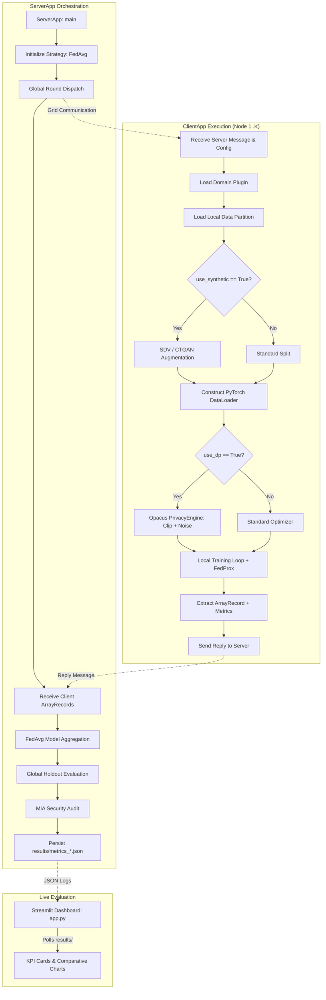

# FedSynAI Architecture & Technical Specifications

This document outlines the architecture, mathematical formulations, threat models, and software design patterns governing the **FedSynAI** platform.

---

## 1. High-Level System Architecture

FedSynAI operates on a modular, decoupled architecture leveraging Flower's **Grid Engine (1.36+)**. It separates domain-specific model logic from federated orchestration, differential privacy, generative augmentation, and adversarial auditing.

---

## 2. Core Modules & Component Responsibilities

### 2.1 Plugin Layer (`pytorchexample/plugins/`)
- **`interfaces.py`**: Declares the abstract base class `FedSynAIPlugin` enforcing:
  - `build_model() -> nn.Module`: Model instantiation.
  - `load_partition(partition_id, num_partitions, batch_size, non_iid, use_synthetic) -> (DataLoader, DataLoader)`: Partition creation with optional Non-IID Dirichlet skew and generative augmentation.
  - `load_centralized_dataset(batch_size) -> DataLoader`: Server-side gold-standard evaluation holdout.
- **`credit_risk.py`**: Implements `FedSynAIPlugin` for credit scoring:
  - 10 financial ratio features (`RevolvingUtilization`, `DebtRatio`, `MonthlyIncome`, etc.).
  - 3-layer MLP (`TabularMLP`) with ReLU activations and Dropout regularisation ($p=0.3, 0.2$).
  - Automatic on-disk dataset caching (`data/cs-training.csv`) to ensure consistent data distributions across Ray actor nodes.

### 2.2 Differential Privacy Engine (`pytorchexample/privacy_engine.py`)
Provides the `DPWrapper` class encapsulating Meta's **Opacus** framework:
- **Per-Sample Gradient Clipping**: Bounds individual gradient contributions to a maximum $L_2$ norm $C$ (`max_grad_norm`).
- **Gaussian Noise Addition**: Adds calibrated noise $\sigma \cdot C \cdot \mathcal{N}(0, \mathbf{I})$ where $\sigma$ is `noise_multiplier`.
- **Rényi DP Budget Accounting**: Computes cumulative privacy expenditure $(\varepsilon, \delta)$ spent across all local batches and rounds.
- **Graceful No-Op Fallback**: When `use_dp=False`, acts as a transparent pass-through with $\varepsilon = \infty$, allowing unified training code across E1–E5.

### 2.3 Generative Synthetic Engine (`pytorchexample/synth_engine.py`)
Mitigates class imbalance and Non-IID data scarcity by synthesizing localized training samples:
- Supports both **CTGAN** (Conditional Generative Adversarial Networks for tabular data) and **GaussianCopula**.
- Multi-version compatibility layer handling both SDV 1.x (`SingleTableMetadata`) and SDV 2.x (`Metadata`).
- Local augmentation only: Training splits are augmented; validation splits remain 100% pristine real data for honest performance evaluation.

### 2.4 Security & Adversarial Auditor (`pytorchexample/security_audit.py`)
Audits the trained global model against **Membership Inference Attacks (MIA)**:
- Evaluates model confidence scores (maximum output probability) on training members vs. unseen non-members.
- Calculates the **Area Under the ROC Curve (ROC-AUC)**:
  - $\text{AUC} \approx 0.50$: **Ideal Privacy** (the adversary performs no better than random guessing).
  - $\text{AUC} \in [0.55, 0.70]$: **Moderate Privacy**.
  - $\text{AUC} > 0.75$: **High Information Leakage** (vulnerable to reconstruction or re-identification).

---

## 3. Mathematical Formulations

### 3.1 FedProx Proximal Regularization (E3, E5)
To prevent local model drift under Non-IID label skew ($\alpha=0.5$), clients optimize the surrogate loss:

$$h_k(w; w^t) = F_k(w) + \frac{\mu}{2} \| w - w^t \|_2^2$$

where:
- $F_k(w)$ is the local cross-entropy loss.
- $w^t$ is the frozen global parameter vector broadcast by the server at round $t$.
- $\mu \ge 0$ is the proximal coefficient (`fedprox-mu=0.01`).

### 3.2 $(\varepsilon, \delta)$-Differential Privacy Guarantee (E4, E5)
A randomized training algorithm $\mathcal{M}$ satisfies $(\varepsilon, \delta)$-DP if for any two adjacent datasets $D, D'$ differing by at most one individual's record, and for any set of outputs $\mathcal{S} \subseteq \text{Range}(\mathcal{M})$:

$$\mathbb{P}[\mathcal{M}(D) \in \mathcal{S}] \le e^\varepsilon \cdot \mathbb{P}[\mathcal{M}(D') \in \mathcal{S}] + \delta$$

In FedSynAI:
- $\delta = 10^{-5}$ (strictly satisfying $\delta \ll \frac{1}{|D|}$ where $|D| = 4,000$).
- $\varepsilon$ is tracked dynamically per client and aggregated on the server.

---

## 4. Experiment Mapping (Review 0 / Review 1 Deliverables)

| Experiment | Workflow | Command Flag | Metric Log |
| :--- | :--- | :--- | :--- |
| **E1: Centralized** | Standalone PyTorch on pooled data | `python run_e1_centralized.py` | `metrics_e1_centralized.json` |
| **E2: Standard FL** | Flower FedAvg, IID partitions | `flwr run .` | `metrics_credit_risk_dpFalse_synthFalse_noniidFalse.json` |
| **E3: Non-IID FL** | Dirichlet skew + FedProx ($\mu=0.01$) | `--run-config "non-iid=true fedprox-mu=0.01"` | `metrics_credit_risk_dpFalse_synthFalse_noniidTrue.json` |
| **E4: DP-FL** | Opacus gradient clip & Gaussian noise | `--run-config "use-dp=true noise-multiplier=1.1"` | `metrics_credit_risk_dpTrue_synthFalse_noniidFalse.json` |
| **E5: FedSynAI** | Full Pipeline (Non-IID + DP + CTGAN) | `--run-config "non-iid=true use-dp=true use-synthetic=true"` | `metrics_credit_risk_dpTrue_synthTrue_noniidTrue.json` |
